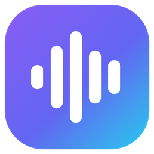
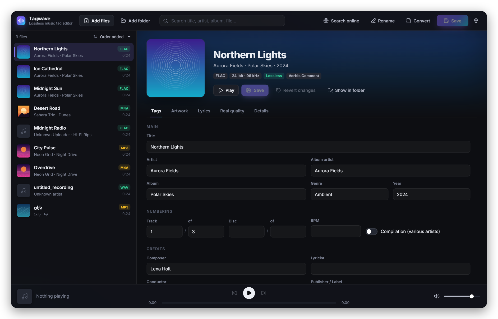
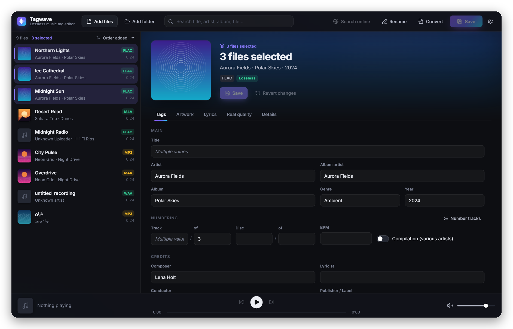
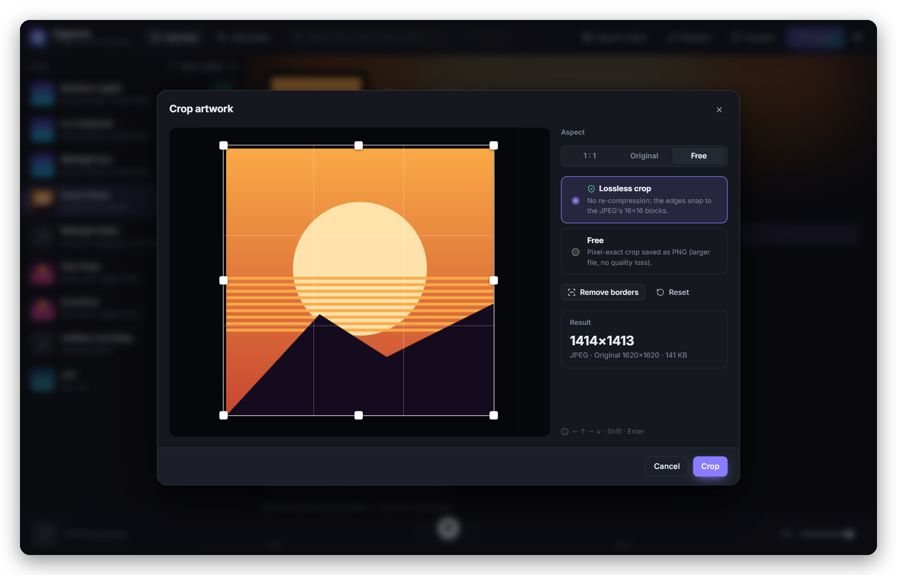
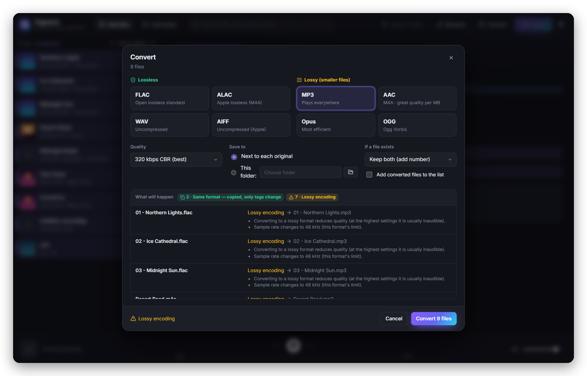
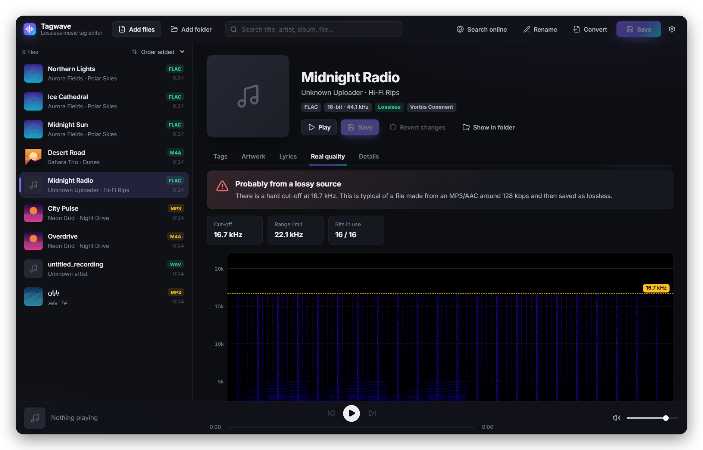
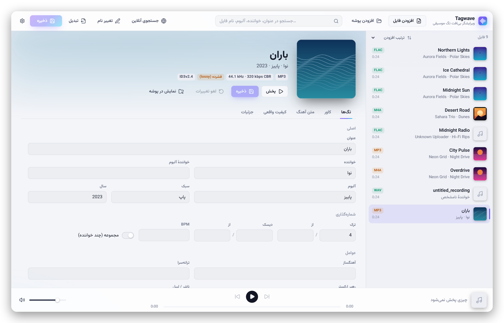
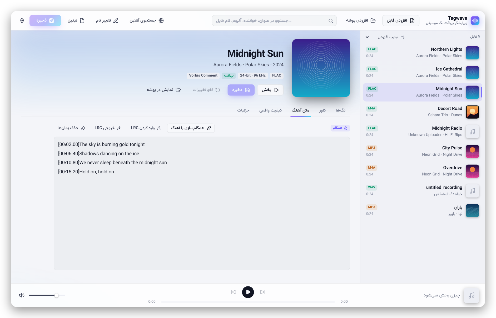

<div align="center">



# Tagwave

**A beautiful, lossless music tag editor for Windows**<br>
**ویرایشگر زیبا و بی‌افت تگ موسیقی برای ویندوز**

[](#system-requirements)
[](#why-tagwave)
[](LICENSE)
[](#build-from-source)
[](#build-from-source)
[](tests)

[**⬇ Download**](../../releases/latest) &nbsp;·&nbsp; [**English**](#english) &nbsp;·&nbsp; [**فارسی**](#فارسی)

<br>



</div>

<br>

## English

### Why Tagwave?

Most tag editors are either ugly, or quietly re-encode your audio or covers. Tagwave is built around one promise:
**editing never lowers the quality of your music or your artwork — not even a little.**

- **Tags are saved on a copy first.** Before the original is replaced, Tagwave compares the audio data of both files.
  If a single byte of audio would change, the save is cancelled and your file is left untouched.
- **Covers are embedded byte-for-byte.** JPEG crops are done *losslessly* in the compressed (DCT) domain — no re-compression.
- **Conversions take the least destructive path,** and lossless conversions are verified **bit-perfect**.
- **Free, offline, no account.** Nothing leaves your computer unless you press *Search online*.

### Features

| | |
|---|---|
| 🏷️ **Full tag editing** | Title, artist, album, album artist, year, genre, track/disc numbers, composer, lyricist, conductor, BPM, ISRC, label, copyright, comment, custom fields |
| 📚 **Batch editing** | Select many files and edit them at once; differing values show as *Multiple values*; one-click track numbering |
| 🖼️ **Artwork** | Add from file, paste (Ctrl+V), drag & drop or online search · multiple images with types · **lossless JPEG crop** · auto *Remove borders* |
| 🎤 **Lyrics** | Plain or synced (LRC) · tap-to-sync editor that stamps each line while the song plays · import/export `.lrc` |
| 🔁 **Convert** | FLAC, ALAC, WAV, AIFF, MP3, AAC, Opus, OGG — with a clear plan of what happens to every file before you start |
| 🔬 **Real quality** | Spectrogram + automatic detection of fake lossless (made from MP3), fake hi-res and fake 24-bit |
| ✏️ **Rename** | Rename files from tags (`{track} - {artist} - {title}`) or fill tags from file names, with live preview |
| 🌐 **Online lookup** | Optional search on MusicBrainz / Cover Art Archive, iTunes and Deezer, with a field-by-field comparison |
| ▶️ **Built-in player** | Plays every supported format, including ALAC, AIFF, WMA and APE |
| 🌗 **Made for you** | English & Persian (RTL) interface · dark, light or system theme |
| 🪟 **Windows integration** | *Edit with Tagwave* in the right-click menu, *Send to*, *Open with* |

### Screenshots

<table>
  <tr>
    <td width="50%"><p align="center"><sub>Batch editing</sub></p></td>
    <td width="50%"><p align="center"><sub>Lossless JPEG crop with border detection</sub></p></td>
  </tr>
  <tr>
    <td><p align="center"><sub>Every conversion is explained before it runs</sub></p></td>
    <td><p align="center"><sub>Catching a FLAC that was made from an MP3</sub></p></td>
  </tr>
  <tr>
    <td><p align="center"><sub>Persian interface, light theme</sub></p></td>
    <td><p align="center"><sub>Synced lyrics</sub></p></td>
  </tr>
</table>

### How conversion protects quality

| Situation | What Tagwave does | Quality |
|---|---|---|
| Same format (e.g. FLAC → FLAC) | Copies the file, only tags change | Identical |
| Same codec, other container (e.g. raw AAC → M4A) | Copies the audio stream, no re-encoding | Identical |
| Lossless → lossless (e.g. FLAC → ALAC) | Keeps sample rate & bit depth, then **verifies bit-perfect** | Identical, verified |
| Lossy → lossless (e.g. MP3 → FLAC) | Decodes to 24-bit | No further loss (file just gets bigger) |
| Anything → lossy (MP3, AAC, Opus, OGG) | Highest settings (e.g. MP3 320 kbps CBR) **with a warning** | Lossy by nature |

### Supported formats

**Edit tags:** MP3 · FLAC · M4A / M4B / MP4 (AAC, ALAC) · OGG Vorbis · Opus · Speex · WAV · AIFF · WMA · APE · WavPack · Musepack · TTA · OptimFROG · DSF<br>
**Convert to:** FLAC · ALAC · WAV · AIFF · MP3 · AAC · Opus · OGG Vorbis<br>
<sub>Raw `.aac` files can't hold tags; Tagwave can move them into M4A without re-encoding.</sub>

### Download & install

1. Download **`Tagwave-Setup-x.y.z.exe`** from the [Releases](../../releases/latest) page.
2. Run it. You can install for yourself only (no admin rights) or for all users.
3. Open Tagwave and drop music files or folders onto the window.

> **Windows SmartScreen:** the installer isn't code-signed, so Windows may show *"Windows protected your PC"* the first time.
> Click **More info → Run anyway**.
>
> **Windows 11:** *Edit with Tagwave* appears under **Show more options** in the right-click menu.

### System requirements

- **Windows 11**, or **Windows 10 (64-bit) that is kept up to date**.
- Tagwave draws its interface with the **Microsoft Edge WebView2 Runtime**, which is part of Windows 11 and of updated Windows 10.
  ⚠️ **On very old Windows 10 installations that haven't received updates, WebView2 may be missing and Tagwave may not open.**
  In that case, run Windows Update or install the free [WebView2 Runtime](https://developer.microsoft.com/microsoft-edge/webview2/) from Microsoft.
- About 300 MB of disk space. No internet connection is needed.

### Build from source

Requirements: Python 3.11, Node.js 20+, FFmpeg (in `PATH` or `FFMPEG_DIR`), and [Inno Setup 6](https://jrsoftware.org/isdl.php) for the installer.

```powershell
py -3.11 -m venv .venv
.venv\Scripts\python -m pip install -r requirements.txt
cd ui; npm install; npm run build; cd ..

.venv\Scripts\python -m pytest tests      # run the test suite
.venv\Scripts\python -m tagwave           # start the app

powershell -ExecutionPolicy Bypass -File packaging\build.ps1   # tests + build + installer -> dist\
```

<details>
<summary><b>Project structure</b></summary>

```
tagwave/core/   tags (mutagen), lossless artwork crop (jpeglib), conversion (FFmpeg),
                quality analysis, rename, online lookup
tagwave/        API, local server (127.0.0.1 + per-run token), WebView2 window, single instance
ui/             interface (Vue 3 + Vite), English & Persian translations
packaging/      PyInstaller spec, Inno Setup script, icon generator, build script
tests/          automated tests (formats, conversions, crop, quality, server)
```
</details>

### License

Tagwave is free software under the [GNU GPL v3](LICENSE). It bundles FFmpeg (GPL) and uses Mutagen, jpeglib, Pillow, NumPy,
pywebview, Vue and the Inter & Vazirmatn fonts — see [third-party notices](packaging/THIRD_PARTY_NOTICES.txt).

<br>

---

<div dir="rtl">

## فارسی

### چرا Tagwave؟

بیشتر ویرایشگرهای تگ یا ظاهر خوبی ندارند، یا بی‌سروصدا صدا یا کاور را دوباره فشرده می‌کنند. Tagwave بر یک قول ساخته شده:
**ویرایش، کیفیت موسیقی و کاور شما را حتی ذره‌ای پایین نمی‌آورد.**

- **تگ‌ها اول روی یک کپی ذخیره می‌شوند.** قبل از جایگزینی فایل اصلی، دادهٔ صوتی دو فایل مقایسه می‌شود؛ اگر حتی یک بایت از صدا فرق کند، ذخیره لغو می‌شود و فایل شما دست‌نخورده می‌ماند.
- **کاورها بایت‌به‌بایت ذخیره می‌شوند.** برش JPEG به‌صورت **بی‌افت** و بدون فشرده‌سازی دوباره انجام می‌شود.
- **تبدیل فرمت همیشه کم‌آسیب‌ترین مسیر را انتخاب می‌کند** و تبدیل‌های بی‌افت **بیت‌به‌بیت تأیید** می‌شوند.
- **رایگان، آفلاین، بدون ثبت‌نام.** تا وقتی خودتان «جستجوی آنلاین» را نزنید، هیچ چیزی از کامپیوترتان خارج نمی‌شود.

### امکانات

| | |
|---|---|
| 🏷️ **ویرایش کامل تگ‌ها** | عنوان، خواننده، آلبوم، خوانندهٔ آلبوم، سال، سبک، شمارهٔ ترک و دیسک، آهنگساز، ترانه‌سرا، رهبر ارکستر، BPM، ISRC، ناشر، حق نشر، توضیحات و فیلدهای سفارشی |
| 📚 **ویرایش گروهی** | چند فایل را با هم انتخاب و یکجا ویرایش کنید؛ مقادیر متفاوت با «مقادیر متفاوت» نشان داده می‌شوند؛ شماره‌گذاری خودکار ترک‌ها |
| 🖼️ **کاور** | افزودن از فایل، چسباندن (Ctrl+V)، کشیدن و رها کردن یا جستجوی آنلاین · چند تصویر با نوع · **برش بی‌افت JPEG** · حذف خودکار حاشیه‌ها |
| 🎤 **متن آهنگ** | ساده یا همگام (LRC) · ابزار همگام‌سازی که هنگام پخش، زمان هر خط را ثبت می‌کند · ورود و خروج `.lrc` |
| 🔁 **تبدیل فرمت** | FLAC، ALAC، WAV، AIFF، MP3، AAC، Opus، OGG — با توضیح دقیق اینکه برای هر فایل چه اتفاقی می‌افتد |
| 🔬 **کیفیت واقعی** | اسپکتروگرام + تشخیص خودکار فایل بی‌افت تقلبی (ساخته‌شده از MP3)، Hi-Res تقلبی و ۲۴ بیت تقلبی |
| ✏️ **تغییر نام** | تغییر نام فایل‌ها از روی تگ یا پر کردن تگ از روی نام فایل، با پیش‌نمایش زنده |
| 🌐 **جستجوی آنلاین** | اختیاری: MusicBrainz / Cover Art Archive، iTunes و Deezer با مقایسهٔ فیلدبه‌فیلد |
| ▶️ **پخش‌کنندهٔ داخلی** | پخش همهٔ فرمت‌ها، حتی ALAC، AIFF، WMA و APE |
| 🌗 **مطابق سلیقهٔ شما** | رابط فارسی (راست‌به‌چپ) و انگلیسی · پوستهٔ تیره، روشن یا هماهنگ با ویندوز |
| 🪟 **یکپارچه با ویندوز** | «Edit with Tagwave» در منوی راست‌کلیک، Send to و Open with |

### تبدیل فرمت چطور از کیفیت محافظت می‌کند

| حالت | کاری که Tagwave انجام می‌دهد | کیفیت |
|---|---|---|
| همان فرمت (مثلاً FLAC به FLAC) | فایل کپی می‌شود و فقط تگ‌ها تغییر می‌کنند | یکسان |
| همان کدک با قالب دیگر (مثلاً AAC خام به M4A) | صدا مستقیم کپی می‌شود، بدون فشرده‌سازی دوباره | یکسان |
| بی‌افت به بی‌افت (مثلاً FLAC به ALAC) | نرخ نمونه‌برداری و عمق بیت حفظ و خروجی **بیت‌به‌بیت تأیید** می‌شود | یکسان و تأییدشده |
| فشرده به بی‌افت (مثلاً MP3 به FLAC) | به ۲۴ بیت تبدیل می‌شود | افت بیشتری ندارد (فقط حجم بیشتر می‌شود) |
| هر فرمتی به فشرده (MP3، AAC، Opus، OGG) | بالاترین تنظیمات (مثلاً MP3 با 320kbps) **همراه با هشدار** | ذاتاً فشرده |

### دانلود و نصب

۱. فایل **`Tagwave-Setup-x.y.z.exe`** را از صفحهٔ [Releases](../../releases/latest) دانلود کنید.<br>
۲. اجرایش کنید. می‌توانید فقط برای خودتان (بدون نیاز به دسترسی ادمین) یا برای همهٔ کاربران نصب کنید.<br>
۳. Tagwave را باز کنید و فایل‌ها یا پوشه‌های موسیقی را روی پنجره رها کنید.

> **هشدار SmartScreen ویندوز:** فایل نصبی امضای دیجیتال ندارد، پس ممکن است بار اول پیام «Windows protected your PC» ببینید.
> روی **More info** و بعد **Run anyway** بزنید.
>
> **ویندوز ۱۱:** گزینهٔ «Edit with Tagwave» در منوی راست‌کلیک زیر **Show more options** قرار دارد.

### پیش‌نیازهای سیستم

- **ویندوز ۱۱** یا **ویندوز ۱۰ (۶۴ بیتی) به‌روز**.
- رابط کاربری Tagwave با **Microsoft Edge WebView2 Runtime** نمایش داده می‌شود که جزء ویندوز ۱۱ و ویندوز ۱۰ به‌روز است.
  ⚠️ **روی ویندوز ۱۰ خیلی قدیمی که آپدیت نشده، ممکن است WebView2 نصب نباشد و برنامه باز نشود.**
  در این صورت Windows Update را اجرا کنید یا [WebView2 Runtime](https://developer.microsoft.com/microsoft-edge/webview2/) را به‌صورت رایگان از سایت مایکروسافت نصب کنید.
- حدود ۳۰۰ مگابایت فضای خالی. به اینترنت نیازی نیست.

### ساخت از روی سورس

پیش‌نیازها: Python 3.11، Node.js 20 به بالا، FFmpeg (در `PATH` یا متغیر `FFMPEG_DIR`) و برای ساخت فایل نصبی [Inno Setup 6](https://jrsoftware.org/isdl.php).
دستورها در [بخش انگلیسی](#build-from-source) آمده‌اند؛ اسکریپت `packaging\build.ps1` تست‌ها را اجرا می‌کند و فایل نصبی را در پوشهٔ `dist` می‌سازد.

### مجوز

Tagwave نرم‌افزار آزاد و تحت مجوز [GNU GPL v3](LICENSE) است. FFmpeg (با مجوز GPL) همراه برنامه است و از Mutagen، jpeglib، Pillow، NumPy، pywebview، Vue و فونت‌های Inter و وزیرمتن استفاده می‌کند — جزئیات در [فهرست نرم‌افزارهای جانبی](packaging/THIRD_PARTY_NOTICES.txt).

</div>
